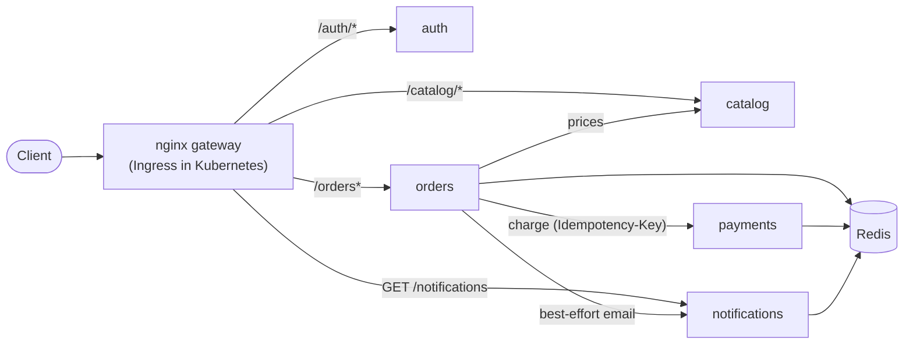

# Kubernetes Microservices Platform (EKS-ready, GitOps)

> Five lightweight Flask services (auth, catalog, orders, simulated payments,
> notifications) packaged with Docker, designed to run on Kubernetes and move to
> Amazon EKS with Argo CD.

> **Status: work in progress.** Phase 1 (services + Docker Compose) is built and tested.
> Kubernetes, Helm, CI, and EKS come next. Nothing is claimed without evidence in
> [`docs/evidence/`](docs/evidence/).

## Project status

| Capability | Status | Evidence |
|---|---|---|
| Five Flask services with health/readiness probes, JSON logs, request ids, Prometheus metrics | ✅ Built, running locally | [compose-status.txt](docs/evidence/compose-status.txt) |
| 67 automated tests, 95% coverage, lint clean | ✅ Passing locally | [tests.txt](docs/evidence/tests.txt) |
| Docker Compose stack behind an nginx gateway; end-to-end smoke test | ✅ 13/13 checks | [smoke-test-compose.txt](docs/evidence/smoke-test-compose.txt) |
| Graceful degradation when a dependency is down | ✅ Measured with real containers | [resilience experiment](docs/evidence/README.md#experiment-does-the-system-degrade-gracefully-when-a-dependency-is-down) |
| Kubernetes manifests / Helm chart on local Kubernetes (kind) | ⏳ Next | — |
| GitHub Actions CI (lint, tests, image build + scan) | ⏳ Planned | — |
| Amazon EKS, Argo CD GitOps, Prometheus/Grafana, IRSA / Pod Identity | 🗺️ Future | — |

**Legend:** ✅ implemented & verified · 🧪 simulated locally · ⏳ planned for this phase · 🗺️ future enhancement

## Architecture (Phase 1, running locally)



| Service | Responsibility | Concept it demonstrates |
|---|---|---|
| **auth** | Checks credentials and issues a signed JWT | Stateless auth: other services verify tokens locally |
| **catalog** | Read-only products and prices | A simple stateless service |
| **orders** | Orchestrates catalog → payments → notifications | Timeouts, safe retries with a deadline, partial failure |
| **payments** | **Simulated** charge; `tok_decline` is declined | Idempotency keys: a retry never charges twice |
| **notifications** | **Simulated** email, stored per user | Best-effort side effects |

`payments` is **not exposed** through the gateway, and notifications are read-only from
outside. Only `orders` may call them.

## Design decisions

- **Liveness vs readiness.** `/healthz` never checks dependencies; `/readyz` checks only
  the service's *own* dependency (Redis), never other services, so one failing service
  does not cascade into all of them being marked unready.
- **Shared state in Redis, not in memory**, so any replica can serve any request.
- **Every outbound call has a timeout**, and payment retries share an overall deadline that
  is shorter than the gateway timeout (a real bug found by experiment; see the
  [evidence](docs/evidence/README.md#finding-the-retry-time-exceeded-the-gateway-timeout-found-and-fixed)).
- **Idempotent payments.** The order id is the `Idempotency-Key`. A retry replays the
  stored result, and `SET NX` closes the race between two simultaneous identical requests.
- **Graceful degradation.** A failed notification never undoes a paid order.
- **One Dockerfile, five images.** Multi-stage, non-root (UID 10001), pip removed,
  read-only filesystem, all capabilities dropped. gunicorn uses 1 worker × 4 threads, so
  each pod is small and its Prometheus counters are accurate; scale by adding pods.
- **Metrics labels use route templates** (`/orders/<order_id>`), not raw paths, to avoid
  creating one metric series per order.
- **JWT verification uses an algorithm allowlist** and requires issuer, audience and expiry
  (tests cover `alg: none`, a wrong key, wrong audience/issuer, and expiry).

## Run it locally

**Prerequisites:** Docker Desktop, and Python 3.14 for the tests.

```bash
cp .env.example .env            # then replace both secrets (instructions inside)
docker compose up -d --build    # gateway at http://localhost:18090
python scripts/smoke_test.py    # 13 end-to-end checks
python scripts/resilience_experiment.py
docker compose down             # stop everything
```

Tests:

```bash
python -m venv .venv
.venv\Scripts\activate          # macOS/Linux: source .venv/bin/activate
pip install -r requirements-dev.txt
pytest --cov && ruff check . && ruff format --check .
```

**Windows note:** Hyper-V/WSL reserve TCP port ranges at boot (check with
`netsh interface ipv4 show excludedportrange protocol=tcp`). Port 8090 was reserved on the
development machine, so the gateway defaults to **18090**. Change `GATEWAY_PORT` in `.env`
if needed.

## Example

```bash
TOKEN=$(curl -s -X POST localhost:18090/auth/login -H "Content-Type: application/json" \
  -d '{"username":"demo","password":"<DEMO_PASSWORD>"}' | python -c "import sys,json;print(json.load(sys.stdin)['access_token'])")
curl -s -X POST localhost:18090/orders -H "Authorization: Bearer $TOKEN" -H "Content-Type: application/json" \
  -d '{"items":[{"product_id":"mug","quantity":2}],"card_token":"tok_visa"}'
```

## Repository layout

```
services/
  common/         app factory (probes, metrics, logs, errors), JWT, HTTP client, Redis
  auth/ catalog/ orders/ payments/ notifications/   one app.py each
tests/            67 unit tests (fakeredis + fake downstream services)
scripts/          smoke_test.py, resilience_experiment.py
gateway/          nginx config for Docker Compose
Dockerfile        one multi-stage file for all five images (--build-arg SERVICE=...)
docker-compose.yml
docs/evidence/    real test output, experiment results, request trace
```

## Known limitations (current phase)

- Redis has no persistence or replication: a restart loses orders and notifications.
- JWTs use a shared HMAC secret. Production should use asymmetric keys (RS256/ES256) so
  only auth can sign.
- Payments and notifications are simulated; there is no real card processing or email.
- No load testing yet; no Kubernetes yet.

## License

[MIT](LICENSE)
