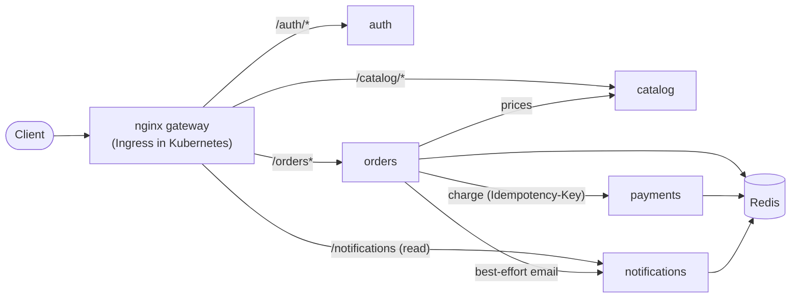
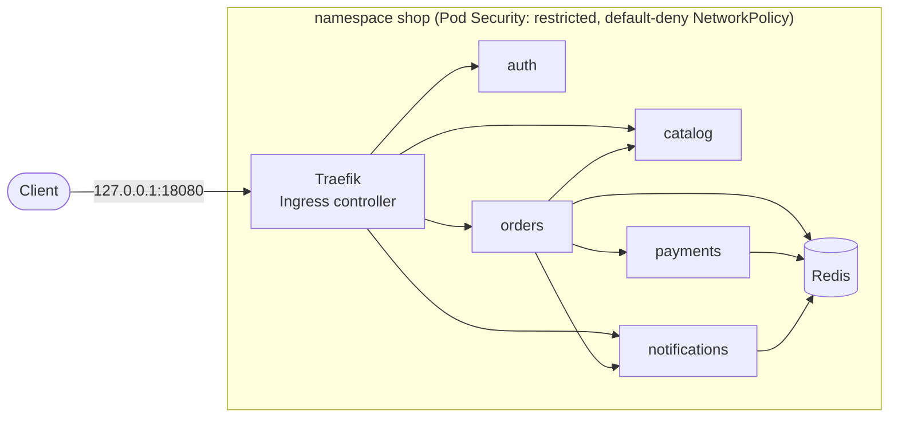

# Kubernetes Microservices Platform (EKS-ready, GitOps)

[](https://github.com/dsgnbyalexx/eks-microservices-gitops-platform/actions/workflows/ci.yml)

> Five lightweight Flask services (auth, catalog, orders, simulated payments,
> notifications) packaged with Docker, designed to run on Kubernetes and move to
> Amazon EKS with Argo CD.

> **Status: work in progress.** Services, Docker Compose, a Helm chart on Kubernetes, and
> CI that deploys to a fresh kind cluster on every push are built and passing. **EKS,
> Argo CD, and Prometheus/Grafana are not built yet.** Nothing is claimed without
> evidence in [`docs/evidence/`](docs/evidence/).

## Project status

| Capability | Status | Evidence |
|---|---|---|
| Five Flask services with health/readiness probes, JSON logs, request ids, Prometheus metrics | ✅ Built, running locally | [compose-status.txt](docs/evidence/compose-status.txt) |
| 68 automated tests, lint clean | ✅ Passing locally | [tests.txt](docs/evidence/tests.txt) |
| Docker Compose stack behind an nginx gateway; end-to-end smoke test | ✅ 14/14 checks | [smoke-test-compose.txt](docs/evidence/smoke-test-compose.txt) |
| Graceful degradation when a dependency is down | ✅ Measured with real containers | [resilience experiment](docs/evidence/README.md#experiment-does-the-system-degrade-gracefully-when-a-dependency-is-down) |
| Helm chart on local Kubernetes (kind 1.37): probes, limits, PDBs, NetworkPolicies, Pod Security "restricted" | ✅ Deployed, 14/14 smoke checks via Ingress | [k8s evidence](docs/evidence/README.md#2026-10-24-phase-2-helm-chart-on-local-kubernetes-kind) |
| Zero-downtime rolling update (0 of 1,442 requests failed; control without preStop: 16 failed) | ✅ Measured | [rollout-experiment.txt](docs/evidence/rollout-experiment.txt) |
| Self-healing, NetworkPolicy enforcement, readiness-vs-liveness during a Redis outage | ✅ Measured | [k8s-experiments.txt](docs/evidence/k8s-experiments.txt) |
| Container images: Alpine-based, 0 known CVEs (was 164 on Debian slim), 99 MB | ✅ Scanned | [image-scan.txt](docs/evidence/image-scan.txt) |
| GitHub Actions CI: lint, 70 tests, 5 image scans, Helm validation, **end-to-end on kind** (smoke + zero-downtime rollout) | ✅ Passing on GitHub | [run 40059539217](https://github.com/dsgnbyalexx/eks-microservices-gitops-platform/actions/runs/40059539217), [all runs](https://github.com/dsgnbyalexx/eks-microservices-gitops-platform/actions/workflows/ci.yml) |
| Amazon EKS, Argo CD GitOps, Prometheus/Grafana, IRSA / Pod Identity | 🗺️ Future | — |

**Legend:** ✅ implemented & verified · 🧪 simulated locally · ⏳ planned for this phase · 🗺️ future enhancement

## Architecture (Phase 1, running locally)



| Service | Responsibility | Concept it demonstrates |
|---|---|---|
| **auth** | Checks credentials and issues a signed JWT | Stateless auth: other services verify tokens locally |
| **catalog** | Read-only products and prices | A simple stateless service |
| **orders** | Orchestrates catalog → payments → notifications | Timeouts, safe retries with a deadline, partial failure |
| **payments** | **Simulated** charge; `tok_decline` is declined | Idempotency keys: a retry never charges twice |
| **notifications** | **Simulated** email, stored per user | Best-effort side effects |

`payments` is **not exposed** through the gateway. Notifications are created through
`POST /internal/notifications`, a path the gateway/Ingress never routes, so outside
callers can only read. This separation by path works with any ingress controller.

## Design decisions

- **Liveness vs readiness.** `/healthz` never checks dependencies; `/readyz` checks only
  the service's *own* dependency (Redis), never other services, so one failing service
  does not cascade into all of them being marked unready.
- **Shared state in Redis, not in memory**, so any replica can serve any request.
- **Every outbound call has a timeout**, and payment retries share an overall deadline that
  is shorter than the gateway timeout (a real bug found by experiment; see the
  [evidence](docs/evidence/README.md#finding-the-retry-time-exceeded-the-gateway-timeout-found-and-fixed)).
- **Idempotent payments.** The order id is the `Idempotency-Key`. A retry replays the
  stored result, and `SET NX` closes the race between two simultaneous identical requests.
- **Graceful degradation.** A failed notification never undoes a paid order.
- **One Dockerfile, five images.** Multi-stage, non-root (UID 10001), pip removed,
  read-only filesystem, all capabilities dropped. gunicorn uses 1 worker × 4 threads, so
  each pod is small and its Prometheus counters are accurate; scale by adding pods.
- **Metrics labels use route templates** (`/orders/<order_id>`), not raw paths, to avoid
  creating one metric series per order.
- **JWT verification uses an algorithm allowlist** and requires issuer, audience and expiry
  (tests cover `alg: none`, a wrong key, wrong audience/issuer, and expiry).

## Kubernetes (Helm chart on kind)



What the chart ([`helm/shop`](helm/shop/)) adds on top of the containers:

| Feature | Setting | Why |
|---|---|---|
| Replicas + rolling updates | 2 replicas; `maxUnavailable: 0`, `maxSurge: 1` | Never fewer ready pods than desired during a deploy |
| Probes | startup + liveness (`/healthz`) + readiness (`/readyz`) | Restart stuck pods; send traffic only to ready ones |
| Graceful shutdown | `preStop` sleep 5 s, then gunicorn drains (30 s grace) | Measured: 0 failed requests vs 16 without the pause |
| Resources | Requests 25m CPU / 64Mi; memory limit 128Mi; **no CPU limit** | Fair scheduling; bounded memory; no CPU throttling |
| PodDisruptionBudgets | `minAvailable: 1` for multi-replica services | Voluntary disruptions never take a service fully down |
| NetworkPolicies | Default deny; only the needed callers allowed | Verified: catalog cannot reach payments or Redis |
| Pod security | Non-root 10001, read-only root FS, no privilege escalation, capabilities dropped, seccomp, no service-account token | Namespace enforces Pod Security "restricted" |
| Ingress | Standard `networking.k8s.io/v1` Ingress | Portable: Traefik locally, AWS Load Balancer Controller on EKS |
| Secrets | `existingSecret`, created outside the chart | No secret values in Git or in Helm values |

**Why Traefik:** the community `ingress-nginx` controller was
[retired](https://www.kubernetes.io/blog/2025/11/11/ingress-nginx-retirement/) (repository
archived; best-effort maintenance ended March 2026), so a new project should not depend
on it. The chart only uses the standard Ingress API.

### Run on kind

```bash
kind create cluster --config k8s/kind-config.yaml
helm repo add traefik https://traefik.github.io/charts
helm upgrade --install traefik traefik/traefik --version 42.1.3 \
  -n traefik --create-namespace -f k8s/traefik-values.yaml --wait

docker compose build                                   # builds shop/<service>:local
kind load docker-image --name shop shop/auth:local shop/catalog:local \
  shop/orders:local shop/payments:local shop/notifications:local

kubectl apply -f k8s/namespace.yaml
kubectl -n shop create secret generic shop-secrets \
  --from-literal=AUTH_SECRET_KEY='<value from .env>' --from-literal=DEMO_PASSWORD='<value from .env>'
helm upgrade --install shop helm/shop -n shop -f helm/shop/values-kind.yaml --wait

SMOKE_BASE_URL=http://127.0.0.1:18080 python scripts/smoke_test.py
scripts/rollout_experiment.sh 5        # zero-downtime check under traffic
kind delete cluster --name shop        # tear everything down
```

`values-kind.yaml` runs one replica of the services not under test, because the
development machine's Docker VM (~2.8 GB) was memory-starved with two of everything
(see the [evidence](docs/evidence/README.md#finding-overloaded-lab-machine-invalidated-the-first-experiment-runs)).

## Continuous integration

[`.github/workflows/ci.yml`](.github/workflows/ci.yml) runs on every push and pull request.
No cloud account is involved.

| Job | Checks |
|---|---|
| **python** | ruff lint and format, 70 unit tests with coverage |
| **images** (×5) | Build each service image; Trivy summary plus a gate on fixable HIGH/CRITICAL |
| **helm** | `helm lint --strict` (default and kind values); kubeconform against Kubernetes 1.37 |
| **e2e** | Create a kind cluster → install Traefik → build and load images → deploy the chart (2 replicas everywhere) → wait for Ingress routes → **14-check smoke test** → **zero-downtime rolling update under traffic** (fails if any request fails or the ingress restarts). Dumps pods, events and logs on failure |

Hardening: a read-only `GITHUB_TOKEN`, SHA-pinned actions, random per-run secrets masked
in logs, timeouts, and concurrency cancellation. Dependabot proposes weekly updates for
pip, Docker, and Actions.

## Run it locally

**Prerequisites:** Docker Desktop, and Python 3.14 for the tests.

```bash
cp .env.example .env            # then replace both secrets (instructions inside)
docker compose up -d --build    # gateway at http://localhost:18090
python scripts/smoke_test.py    # 14 end-to-end checks
python scripts/resilience_experiment.py
docker compose down             # stop everything
```

Tests:

```bash
python -m venv .venv
.venv\Scripts\activate          # macOS/Linux: source .venv/bin/activate
pip install -r requirements-dev.txt
pytest --cov && ruff check . && ruff format --check .
```

**Windows note:** Hyper-V/WSL reserve TCP port ranges at boot (check with
`netsh interface ipv4 show excludedportrange protocol=tcp`). Port 8090 was reserved on the
development machine, so the gateway defaults to **18090**. Change `GATEWAY_PORT` in `.env`
if needed.

## Example

```bash
TOKEN=$(curl -s -X POST localhost:18090/auth/login -H "Content-Type: application/json" \
  -d '{"username":"demo","password":"<DEMO_PASSWORD>"}' | python -c "import sys,json;print(json.load(sys.stdin)['access_token'])")
curl -s -X POST localhost:18090/orders -H "Authorization: Bearer $TOKEN" -H "Content-Type: application/json" \
  -d '{"items":[{"product_id":"mug","quantity":2}],"card_token":"tok_visa"}'
```

## Repository layout

```
services/
  common/         app factory (probes, metrics, logs, errors), JWT, HTTP client, Redis
  auth/ catalog/ orders/ payments/ notifications/   one app.py each
tests/            68 unit tests (fakeredis + fake downstream services)
scripts/          smoke_test.py, resilience_experiment.py, availability_probe.py, rollout_experiment.sh
gateway/          nginx config for Docker Compose
helm/shop/        Helm chart: Deployments, Services, Ingress, PDBs, NetworkPolicies, Redis
k8s/              kind cluster config, Traefik values, namespace with Pod Security labels
Dockerfile        one multi-stage file for all five images (--build-arg SERVICE=...)
docker-compose.yml
docs/evidence/    real test output, experiment results, request trace
```

## Known limitations (current phase)

- Redis has no persistence or replication: a restart loses orders and notifications.
- JWTs use a shared HMAC secret. Production should use asymmetric keys (RS256/ES256) so
  only auth can sign.
- Payments and notifications are simulated; there is no real card processing or email.
- No load testing beyond 20 requests/second.
- Kubernetes is tested on a **single-node** kind cluster: pod spreading across nodes and
  PodDisruptionBudgets during node drains are not exercised.
- No HorizontalPodAutoscaler yet (needs metrics-server), and no egress NetworkPolicies.

## License

[MIT](LICENSE)
